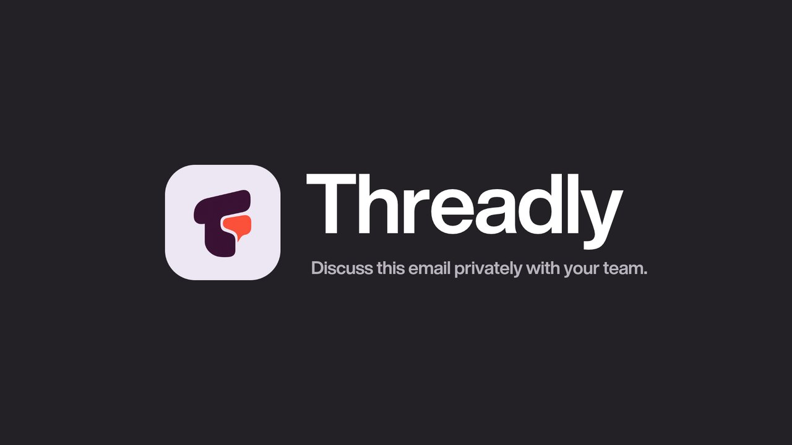
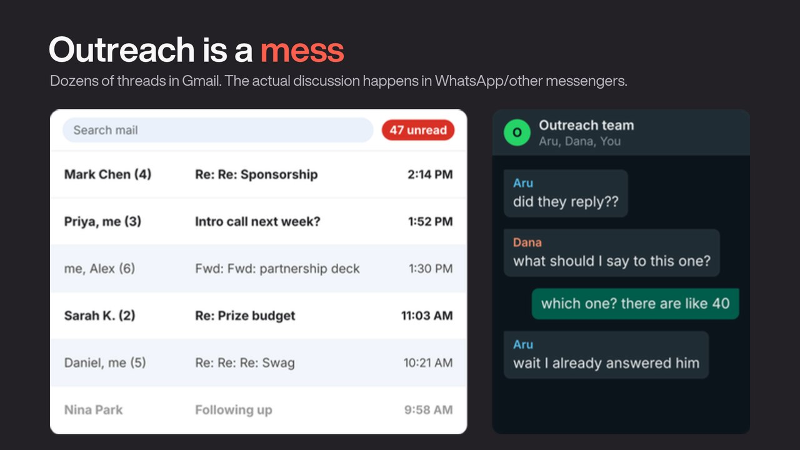
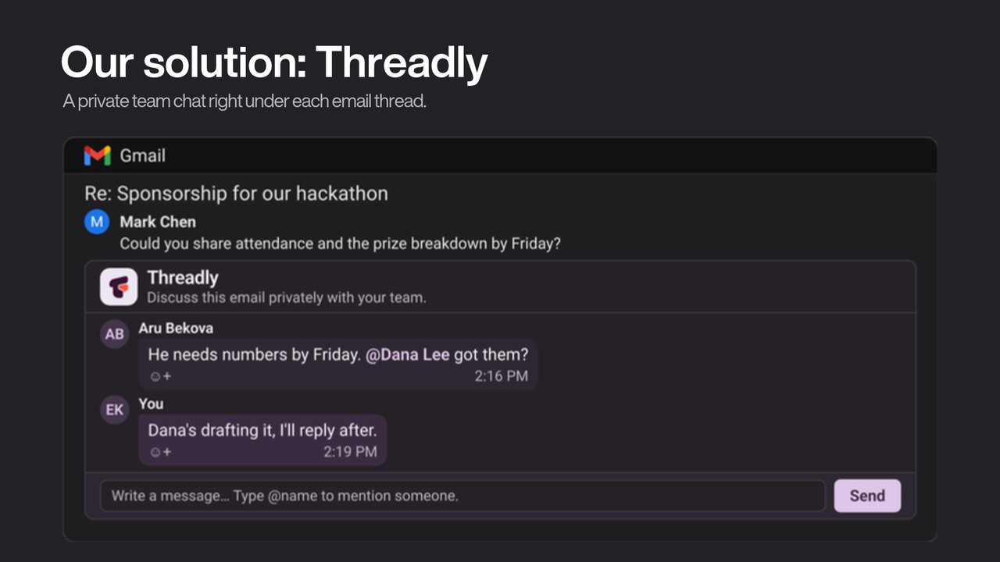
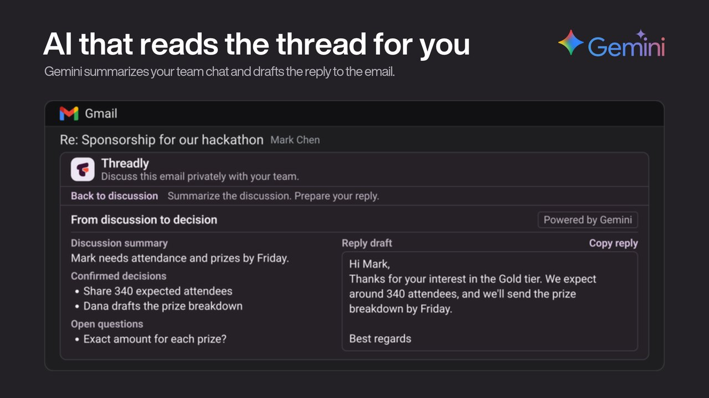

<p align="center">
  
</p>

# Threadly

A private team chat attached to every Gmail thread. Your team talks about the email right next to it, and Gemini turns that talk into a reply draft.

Threadly is a Chrome extension built at a hackathon. The manifest still calls it "Gmail Team Chat", so that's the name you'll see in `chrome://extensions` and on the install page.

## The problem



Team outreach lives in Gmail, but the conversation about it happens somewhere else. Someone pastes a screenshot into WhatsApp, someone asks "which email?", and two people answer the same sponsor. The email and the decision about it never end up in the same place.

## The solution



Threadly puts a team chat panel inside Gmail, attached to the email you have open. Everyone in your workspace who opens the same email conversation in their own Gmail account lands in the same discussion. Nobody has to paste a link or pick a thread by hand. Different emails get different discussions, and different workspaces never see each other's history.

The slides show the panel below the email. The current build places it in a sidebar to the right of the thread.

## Gemini assistant



Open **Gemini assistant** above the chat history and click **Summarize & draft reply**. You get:

- a short summary of what the team discussed
- confirmed decisions, each tied to the chat messages that support it
- open questions the team hasn't settled
- an editable reply to the email, in a Professional, Friendly or Concise tone

**Copy reply** copies your edited draft to the clipboard. Threadly never sends email and never posts to the chat on your behalf. If new messages arrive after you generate, the draft is marked out of date.

By default Gemini only sees the team discussion. Tick **Include the visible email** to add the rendered text of the open thread. You get a preview you can edit before generating. Attachments and collapsed messages are left out, and the text is capped at 20,000 characters.

## Features

- **Private workspaces.** Create a workspace and you become its owner. Owners invite teammates by their Google email, revoke pending invites and remove members. Invitations expire after 7 days and only work for the invited, verified email.
- **Invite links.** Each pending invitation has a copyable link. It opens the install page, then hands off to the installed extension.
- **Automatic thread matching.** Threadly identifies the email conversation by its root `Message-ID` header, hashed with SHA-256, so the same email maps to one discussion per workspace even though every Gmail account uses different internal IDs.
- **@mentions.** Type `@` to pick a teammate with the mouse or arrow keys. Mentions are highlighted in the chat.
- **Emoji reactions.** Six reactions (👍 ❤️ 🔥 😂 😮 👎), one per person per message. Click yours again to remove it.
- **Activity.** The toolbar popup lists discussions with unread messages and mentions, with an **Open in Gmail** button.
- **Realtime.** New messages arrive through Supabase Realtime, with a polling fallback every 8 seconds while the chat is visible.
- **Avatars.** Google profile photos next to messages, or initials when there's no photo.
- **Several workspaces.** Switch between them from the chat header. Each one keeps its own history.
- **Gemini summaries and reply drafts**, described above.
- **Firefox (experimental).** The build loads as a temporary add-on, but Google sign-in and Gmail matching have only been tested in Chrome.

## Privacy

What goes to Supabase: chat messages, reactions, workspace membership, local Gmail thread IDs and the SHA-256 hash of the email conversation identity. Email bodies, subjects and raw headers stay in your browser.

What goes to Gemini: only when you click Generate, the most recent stored messages of the current discussion (up to 500 messages or about 90,000 characters) plus any email text you chose to include. Summaries and drafts are not saved to the database. They are cleared when you switch account or discussion.

Access control is enforced in Postgres with row-level security. The Gemini function reads messages with your own session token, not a service-role key, so it can only see what you can see.

## How it works

```
Gmail tab
├── content.js        finds the open thread, injects the chat iframe
├── chat.html/js      the chat panel (Supabase client, mentions, reactions, assistant)
└── invite-bridge.js  background worker: reads original headers, hashes Message-ID,
                      opens invite links from the install page

Supabase
├── Auth              Google sign-in (PKCE)
├── Postgres + RLS    workspaces, invitations, discussions, messages, reactions
├── Realtime          live message delivery
└── Edge Function     thread-assistant -> Gemini API

Vercel                install page with the zipped extension (site/)
```

To match a thread, the content script asks the background worker to fetch the message's original headers through Gmail's "Download original" endpoint with your current session. The worker hashes the root of `References` (or `In-Reply-To`, or the message's own `Message-ID`), cancels the download once the headers are in, and returns only the hash. That endpoint is not a public API. If Gmail changes it, the panel shows a matching error and a **Retry email matching** button instead of quietly creating a separate chat.

## Getting started

You need Node.js 22 or newer, a Supabase project and a Google Cloud project.

### 1. Supabase and Google sign-in

1. Create a Supabase project. Apply every file in `supabase/migrations/` in filename order, either in the SQL Editor or with the CLI:
   ```sh
   supabase link --project-ref <project-ref>
   supabase db push
   ```
2. In Google Cloud, create a **Web application** OAuth client. Add `https://<project-ref>.supabase.co/auth/v1/callback` as an authorized redirect URI. If the OAuth app is in testing mode, add your testers' Google accounts.
3. In Supabase Auth, enable the Google provider with that client ID and secret.
4. In Supabase Auth, URL Configuration, add this redirect URL:
   ```
   https://ehlcjjpfplfhiaefiljbfehibbialjeh.chromiumapp.org/supabase-auth
   ```
   The `key` in `manifest.json` pins the extension ID, so this URL stays the same for every unpacked install.

### 2. Build the extension

```sh
cp .env.example .env    # set SUPABASE_URL and SUPABASE_PUBLISHABLE_KEY
npm ci
npm run build
```

`.env` only takes the project URL and the publishable (or anon) key. The build rejects any other kind of key. Keep the Google client secret and the Gemini key out of it.

### 3. Load it in Chrome

Open `chrome://extensions`, turn on Developer mode, click **Load unpacked** and pick `dist`. Click the extension icon, sign in with Google, then reload Gmail and open a thread.

In Firefox, open `about:debugging#/runtime/this-firefox`, click **Load Temporary Add-on** and pick `dist/manifest.json`. Firefox removes it when it closes.

### 4. Turn on Gemini

1. Make sure `20261123110000_assistant_usage.sql` is applied. It adds a limit of 20 generation attempts per user per hour, across all workspaces.
2. Add `GEMINI_API_KEY` (from Google AI Studio) under Supabase Dashboard, Edge Functions, Secrets.
3. Deploy the function:
   ```sh
   supabase functions deploy thread-assistant --project-ref <project-ref>
   ```
4. Optional secrets: `GEMINI_MODEL` (default `gemini-3.5-flash-lite`), `EXTENSION_ORIGIN` (default `chrome-extension://ehlcjjpfplfhiaefiljbfehibbialjeh`) and `THREADLY_PUBLISHABLE_KEY` if your project only has the new-style keys.
5. Rebuild, reload the extension and refresh Gmail.

For local function development, copy `supabase/functions/.env.example` to `supabase/functions/.env` and run:

```sh
supabase functions serve thread-assistant --env-file supabase/functions/.env
```

## Usage

1. Click the toolbar icon (or right-click it and choose **Options** for a full tab). Sign in, type a workspace name and click **Create**.
2. Invite teammates by their Google email. They accept in **Workspace settings** after signing in, or you can send them the invitation link.
3. Open any email in Gmail. The discussion for your selected workspace appears next to it.
4. Enter sends, Shift+Enter adds a new line. Type `@` to mention someone. Use the ☺+ button on a message to react.
5. Click **Gemini assistant** when you're ready to reply, generate, edit the draft, copy it into Gmail.

## Development

```sh
npm test            # node --test tests/*.test.js
npm run build       # extension into dist/
npm run build:site  # extension + install page into site-dist/
```

The database tests run the real migrations against PGlite (in-memory Postgres) with simulated Supabase auth roles. They cover workspace isolation, per-thread history, email-bound and expired or revoked invitations, member removal, spoofed authors and cross-workspace references. The assistant tests mock Gemini, so no API key or real account is needed.

### Install page on Vercel

`vercel.json` runs `npm run build:site` and serves `site-dist`. Set `SUPABASE_URL` and `SUPABASE_PUBLISHABLE_KEY` in the Vercel project. Without them the page builds but hides the download. The extension only accepts invitation handoffs from `https://gmail-team-chat.vercel.app`.

## Tech stack

- Chrome Manifest V3 extension in plain JavaScript, bundled with esbuild
- Supabase: Auth (Google), Postgres with RLS, Realtime, Edge Functions (Deno)
- Google Gemini API with structured JSON output
- PGlite and `node:test` for tests
- Vercel for the install page

<details>
<summary>Operational notes</summary>

- **Migrations.** Always apply them in filename order. Existing installs only need the ones they're missing. The frontend refuses to open the old global chat if the private-workspace schema is missing, and the automatic-discussion RPC (`20261123100000_automatic_thread_discussion.sql`) is required. There is no fallback to per-user chats.
- **Legacy messages.** The privacy migration keeps old global messages without a workspace but hides them from every normal account. A database admin can review them separately. Older account-specific discussions are merged into the matched email discussion only when that history can be attributed to the email safely.
- **Member removal.** Removing someone blocks new reads and writes right away. History already on their screen is cleared at the next membership refresh, every 30 seconds while the panel is visible or when they return to it.
- **Thread matching details.** Supports legacy hex message IDs and Gmail's `msg-f:` / `msg-a:` IDs. It reuses the account's `ik` session key from Gmail links. The key and raw headers never reach the chat iframe or Supabase. After updating, reload the extension and approve the `mail-attachment.googleusercontent.com` host permission if Chrome asks.
- **Sessions.** Auth lives in `chrome.storage.local`, shared by the popup and the Gmail panel. Open panels pick up sign-in, refresh and sign-out without a Gmail reload. Sign-in runs in an extension-owned window that closes itself after Supabase returns the PKCE code. After upgrading from an old build, reload the extension, refresh Gmail and sign in once more.
- **Gemini function auth.** `supabase/config.toml` keeps the gateway JWT check on, and the handler verifies the token against Supabase Auth again. If your project uses asymmetric JWT signing keys and the gateway rejects them, decide how to handle gateway auth before going live.
- **Gemini limits and cost.** The per-user limit is not a spending cap. Use quotas in Google AI Studio for that. Drafts can still get facts wrong, so read them before sending. Only use the assistant on content your team is fine sharing with Google under your API terms.
- **References.** [Gemini content generation](https://ai.google.dev/api/generate-content), [structured output](https://ai.google.dev/gemini-api/docs/structured-output), [Supabase function secrets](https://supabase.com/docs/guides/functions/secrets).

</details>
